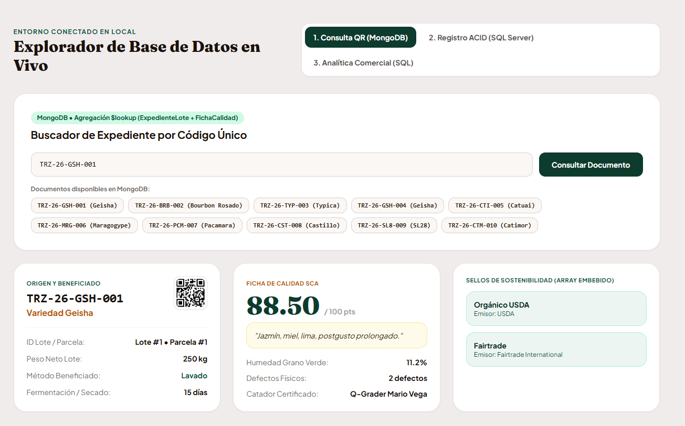
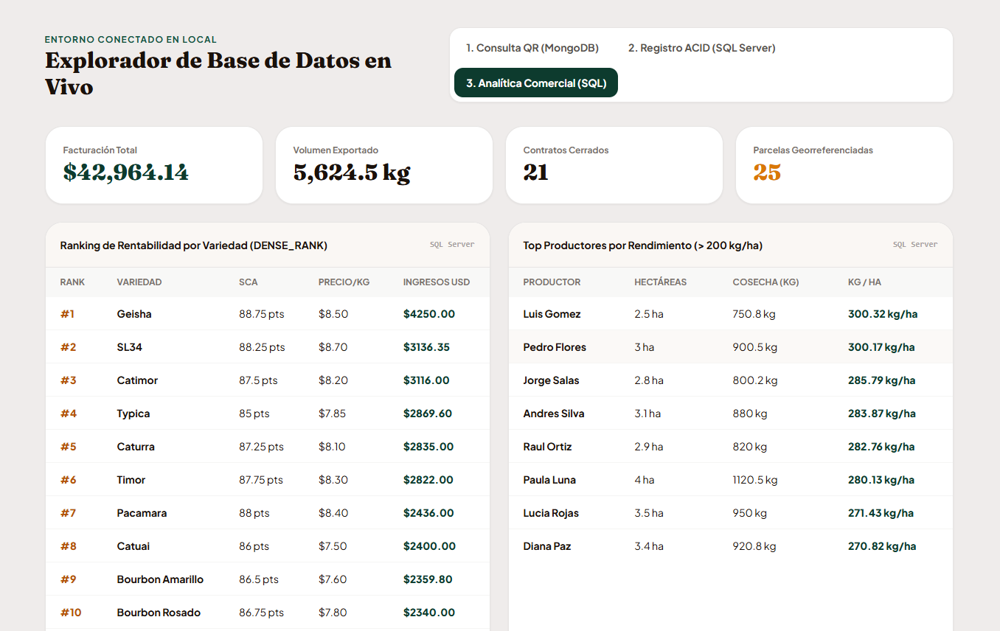
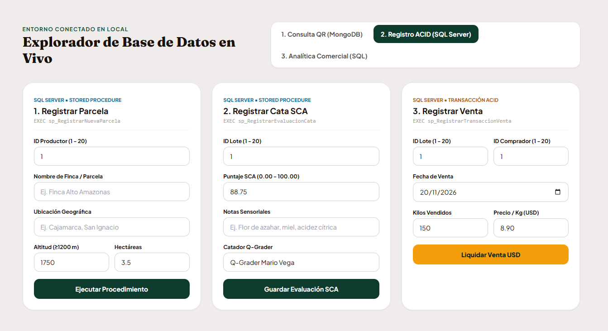

# Specialty Trace

**Especialidad en trazabilidad de café peruano**: aplicación web que integra una API con FastAPI y una arquitectura de persistencia políglota mediante SQL Server y MongoDB.

Permite consultar expedientes de lotes por código, registrar parcelas, evaluaciones de cata y ventas con procedimientos almacenados, y visualizar indicadores analíticos de variedad y rentabilidad.

## Vista previa


| MongoDB | SQL Server |
|---|---|
|  |  |



## Características

- Consulta rápida de lotes y trazabilidad desde MongoDB.
- Registro transaccional de parcelas, catas y ventas en SQL Server.
- Procedimientos almacenados y reglas de integridad en la base relacional.
- Dashboard con ventas, rentabilidad por variedad y rendimiento de productores.
- Interfaz responsive desarrollada en HTML, Tailwind CSS y JavaScript.
- Diagramas lógico y físico del modelo de datos.

## Arquitectura

```text
frontend/index.html
        |
        | HTTP/JSON
        v
backend/main.py (FastAPI)
        |                       |
        v                       v
SQL Server                 MongoDB
transacciones ACID          expedientes y calidad
```

SQL Server gestiona entidades relacionales y operaciones críticas. MongoDB almacena documentos flexibles para consultas rápidas de trazabilidad mediante agregaciones `$lookup`.

## Tecnologías

- Frontend: HTML5, Tailwind CSS, JavaScript
- API: Python, FastAPI, Pydantic
- Relacional: Microsoft SQL Server, SQL expresado en T-SQL
- Documental: MongoDB
- Conectores: `pyodbc` y `PyMongo`

## Requisitos

- Python 3.10 o superior
- Microsoft SQL Server Express con ODBC Driver 17 for SQL Server
- MongoDB Community
- Navegador web moderno

## Configuración

### 1. SQL Server

Ejecute el script completo:

```text
frontend/sources/scripts/SpecialtyTraceDB_Script.sql
```

El script crea la base `SpecialtyTraceDB`, las tablas, los datos de ejemplo y los procedimientos almacenados utilizados por la API.

### 2. MongoDB

Abra `SpecialtyTraceDB_mongodb.js` en MongoDB Shell o MongoDB Compass y ejecute su contenido para crear la base `SpecialtyTraceDB;`, las colecciones y los datos de demostración.

También se incluye el modelo:

```text
frontend/sources/scripts/MongoDB model SpecialtyTraceDB.hck.json
```

### 3. Backend

Desde la raíz del proyecto:

```powershell
python -m venv .venv
.venv\Scripts\Activate.ps1
pip install -r backend\requirements.txt
```

Puede usar los valores predeterminados o configurar las variables de entorno. Ejecute el siguiente comando antes de iniciar el servidor si utiliza una instancia diferente:

```powershell
$env:SQL_SERVER="localhost\SQLEXPRESS"
$env:SQL_DATABASE="SpecialtyTraceDB"
$env:SQL_DRIVER="ODBC Driver 17 for SQL Server"
$env:MONGO_URI="mongodb://localhost:27017/"
$env:MONGO_DB_NAME="SpecialtyTraceDB;"
```

Inicie la API:

```powershell
cd backend
uvicorn main:app --reload
```

Documentación interactiva disponible en:

- Swagger UI: http://127.0.0.1:8000/docs
- ReDoc: http://127.0.0.1:8000/redoc

### 4. Frontend

Abra `frontend/index.html` directamente en el navegador o sirva la carpeta con cualquier servidor estático:

```powershell
cd frontend
python -m http.server 5500
```

Acceda a http://127.0.0.1:5500.

El frontend espera que la API esté disponible en `http://127.0.0.1:8000/api`.

## Estructura del proyecto

```text
specialty-trace-app/
├── backend/
│   ├── main.py
│   ├── requirements.txt
│   └── .env.example
└── frontend/
    ├── index.html
    └── sources/
        ├── diagrams/
        ├── images/
        └── scripts/
```

## API

| Método | Ruta | Descripción |
|---|---|---|
| `GET` | `/api/mongo/lotes` | Lista códigos de trazabilidad disponibles |
| `GET` | `/api/mongo/trazabilidad/{codigo}` | Obtiene expediente consolidado del lote |
| `POST` | `/api/sql/parcelas` | Registra una parcela |
| `POST` | `/api/sql/catas` | Registra una evaluación sensorial |
| `POST` | `/api/sql/ventas` | Registra una venta |
| `GET` | `/api/sql/dashboard` | Obtiene indicadores analíticos |

## Publicación en GitHub

Este proyecto no debe incluir bases de datos locales ni archivos personales. Después de verificar los cambios:

```powershell
git init
git add .
git commit -m "Preparar Specialty Trace para publicación"
git branch -M main
git remote add origin https://github.com/USUARIO/REPOSITORIO.git
git push -u origin main
```

## Recursos del modelo

- [Diagrama físico](frontend/sources/images/diagrama-fisico.png)
- [Diagrama lógico](frontend/sources/images/diagrama-logico.png)
- [Modelo ERD](frontend/sources/diagrams/diagram.erd)
